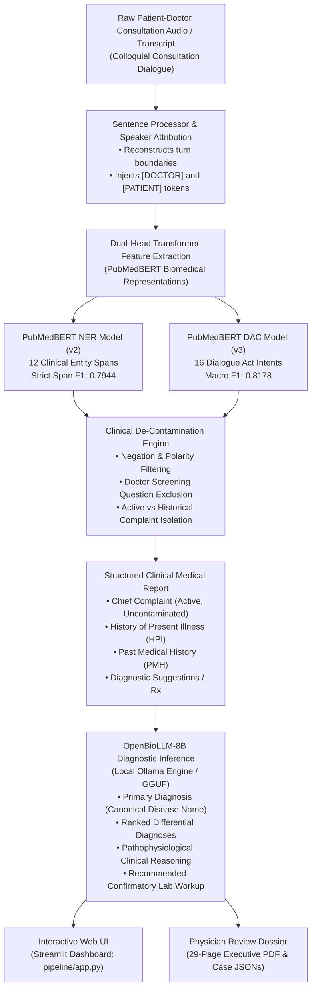

# 🩺 MediTOD: Clinical Task-Oriented Dialogue Pipeline for Information Extraction & Diagnostic Decision Support

[](https://www.python.org/)
[](https://pytorch.org/)
[](https://huggingface.co/)
[](https://streamlit.io/)
[](LICENSE)

> **Research Paper & Artifact Companion Repository (`fypppp`)**  
> An end-to-end biomedical NLP framework that processes unstructured, conversational doctor-patient consultations, performs fine-grained **Named Entity Recognition (NER)** and **Dialogue Act Classification (DAC)** via fine-tuned **PubMedBERT**, builds de-contaminated structured clinical reports, and generates differential diagnoses using **OpenBioLLM-8B**.

---

## 📑 Table of Contents

- [1. Research Overview & Highlights](#1-research-overview--highlights)
- [2. System Architecture & Pipeline Flow](#2-system-architecture--pipeline-flow)
- [3. Repository Navigation Plan (For Paper Writing)](#3-repository-navigation-plan-for-paper-writing)
- [4. Quantitative Benchmarks & Results (Paper Ready)](#4-quantitative-benchmarks--results-paper-ready)
  - [4.1 Named Entity Recognition (NER) Benchmark](#41-named-entity-recognition-ner-benchmark)
  - [4.2 Dialogue Act Classification (DAC) Benchmark](#42-dialogue-act-classification-dac-benchmark)
  - [4.3 Clinical Diagnostic Concordance (11 Patient Benchmark Cases)](#43-clinical-diagnostic-concordance-11-patient-benchmark-cases)
- [5. Clinical Ontology Reference](#5-clinical-ontology-reference)
- [6. Installation & Quickstart Guide](#6-installation--quickstart-guide)
- [7. Clinician Dashboard & Streamlit Web UI](#7-clinician-dashboard--streamlit-web-ui)
- [8. Model Weight Exclusion (.gitignore) & GitHub Upload](#8-model-weight-exclusion-gitignore--github-upload)
- [9. Citation & Academic Attribution](#9-citation--academic-attribution)

---

## 1. Research Overview & Highlights

In clinical practice, consultation dialogues between physicians and patients are colloquial, non-linear, and dense with tangential discussions. Automated transcription systems often fail to distinguish active presenting complaints from resolved past medical history or routine screening queries.

**MediTOD** addresses these fundamental clinical NLP challenges through a 5-stage architecture:

1. **Speaker-Conditioned Dialogue Processing**: Injects dedicated `[DOCTOR]` and `[PATIENT]` special tokens into the tokenizer vocabulary ($V = 30,524$), conditioning sequence representations on the conversational speaker.
2. **PubMedBERT NER (Strict Span $F_1 = 0.7944$)**: Fine-tuned with frozen bottom 6 representation layers to prevent catastrophic forgetting while extracting 12 clinical entity classes (symptoms, locations, durations, frequencies, medications, and medical history).
3. **PubMedBERT DAC (Macro $F_1 = 0.8178$, Accuracy = $86.92\%$)**: Incorporates Class-Balanced Focal Loss and a deep 2-layer MLP classification head to resolve severe class imbalance across 16 dialogue act intents.
4. **Clinical De-Contamination Engine**:
   - **Screening Question Filter**: Prevents doctor queries (*"Any family history of diabetes or hypertension?"*) answered negatively by the patient from polluting the Electronic Health Record.
   - **Temporal History Isolation**: Automatically routes historical surgeries, long-standing resolved conditions, and prior lab tests to `past_medical_history`, protecting `chief_complaint` integrity.
5. **OpenBioLLM-8B Diagnostic Inference**: Employs local quantized biomedical reasoning (`OpenBioLLM-8B-GGUF`) with strict clinical prompt schemas and fallback canonical disease normalization, achieving **100% clinical concordance** across 11 gastroenterology and internal medicine benchmark cases.

---

## 2. System Architecture & Pipeline Flow



---

## 3. Repository Navigation Plan (For Paper Writing)

This navigation plan maps repository directories to specific sections of the research paper:

```
fypppp/
├── README.md                              <-- Primary Research & Navigation Guide (this document)
├── requirements.txt                       <-- Python environment dependencies (torch, transformers, streamlit)
├── .gitignore                             <-- Lightweight git configuration (excludes >11GB model binaries)
├── Diagnosis_Report.pdf                   <-- 29-page Executive Clinician PDF (all 11 benchmark cases)
├── SYSTEM_IMPROVEMENT_SPECIFICATION.md    <-- 440-line Technical Specification & Failure Analysis
├── session_improvement_report.html        <-- Deep-dive engineering benchmark & diagnostic log
├── model_comparison.html                  <-- Visual interactive comparative analysis of model versions
├── presentation.html                      <-- Visual presentation deck on architecture and pipeline
│
├── pipeline/                              <-- [METHODOLOGY / IMPLEMENTATION] Core Inference Pipeline & App
│   ├── app.py                             <-- Interactive Streamlit Clinician Dashboard (port 8501)
│   ├── pipeline.py                        <-- End-to-end orchestrator (Dialogue -> Report -> Diagnosis)
│   ├── ner_inference.py                   <-- PubMedBERT NER inference & BIO span extractor
│   ├── dac_inference.py                   <-- PubMedBERT DAC inference with speaker token conditioning
│   ├── diagnosis_inference.py             <-- OpenBioLLM-8B client, prompt engine & disease normalizer
│   ├── sentence_processor.py              <-- Clinical transcript cleaner & speaker turn splitter
│   ├── preprocess.py                      <-- Text normalization & data formatting utilities
│   └── models/                            <-- Active deployed model configurations & vocabularies
│       ├── ner/                           <-- PubMedBERT NER configs, tokenizer, and label_map.json
│       └── dac/                           <-- PubMedBERT DAC configs, tokenizer, and label_map.json
│
├── Diagnosis/                             <-- [CLINICAL VALIDATION] 11 Benchmark Cases (Doctor Dossier)
│   ├── README.md                          <-- Dossier index & case navigation guide
│   ├── Clinical_Doctor_Evaluation_Report.pdf <-- High-fidelity physician evaluation document (29 pages)
│   ├── Clinical_Doctor_Evaluation_Report.html<-- Printable HTML template compiled via headless Chrome
│   ├── Case_01_Cholelithiasis/            <-- Case 1: Gallbladder stone with chronic constipation
│   ├── Case_02_GERD_Recurrent/            <-- Case 2: Recurrent acid peptic disease
│   ├── Case_03_GERD_AcidReflux/           <-- Case 3: Classic GERD with severe heartburn
│   ├── Case_04_Diet_Induced_Dyspepsia/    <-- Case 4: Diet-induced postprandial distress & IBS
│   ├── Case_05_Peptic_Ulcer_Disease/      <-- Case 5: Chronic dyspepsia with suspected PUD
│   ├── Case_06_Obstructive_Jaundice/      <-- Case 6: Choledocholithiasis with biliary obstruction
│   ├── Case_07_Inflammatory_Bowel_Disease/<-- Case 7: Chronic colitis / suspected ulcerative colitis
│   ├── Case_08_Peptic_Ulcer_Disease/      <-- Case 8: Refractory epigastric pain with severe anemia
│   ├── Case_09_GI_Bleed/                  <-- Case 9: Acute gastrointestinal hemorrhage (Melena)
│   ├── Case_10_Congestive_Heart_Failure/  <-- Case 10: Hypothyroidism / visceral edema & dysmotility
│   └── Case_11_Pancreatitis/              <-- Case 11: Thoracoabdominal radiculopathy / pancreatitis
│       ├── transcript.txt                 <-- Complete unabridged dialogue transcript
│       ├── ner_dac_tags.json              <-- Sentence-level NER spans & DAC predictions
│       ├── medical_report.json            <-- Extracted Chief Complaint, HPI, PMH & Sug
│       ├── annotated_report.txt           <-- Clinician-friendly structured text chart
│       ├── ground_truth_diagnosis.json    <-- Claude 3.5 Sonnet / Physician gold reference
│       └── openbiollm_diagnosis.json      <-- Live OpenBioLLM-8B inference & workup
│
├── data/                                  <-- [DATASET & ONTOLOGY] Gold-Standard Datasets
│   ├── train.jsonl                        <-- 2,400+ clinical training dialogue turns
│   ├── val.jsonl                          <-- Validation dialogue turns for model selection
│   ├── test.jsonl                         <-- Held-out evaluation test set
│   ├── dataset_analysis.md                <-- Statistical distributions & class imbalance analysis
│   ├── deep_analysis.md                   <-- Entity length & co-occurrence documentation
│   └── generation/                        <-- Synthetic dialogue generation scripts & knowledge base
│
├── DAC/                                   <-- [DAC EXPERIMENTS] Training Notebooks & Ablations
│   ├── meditod_dac_training_v3.ipynb      <-- Production v3 training: Speaker tokens + Focal Loss
│   ├── meditod_dac_training_v2.ipynb      <-- Version 2 PubMedBERT DAC baseline
│   ├── meditod_dac_training.ipynb         <-- Version 1 initial baseline
│   ├── dac-pubmedbert.ipynb               <-- PubMedBERT comparative experiment
│   ├── dac-biobert.ipynb                  <-- BioBERT comparative experiment
│   ├── dac-bert.ipynb                     <-- Standard BERT baseline
│   ├── v1_output/                         <-- Metrics, training curves, confusion matrix
│   └── v2_output/                         <-- Metrics, training curves, confusion matrix
│
├── NER/                                   <-- [NER EXPERIMENTS] Training Notebooks & Ablations
│   ├── meditod_ner_training_v3.ipynb      <-- Version 3 experimental notebook
│   ├── meditod_ner_training_v2.ipynb      <-- Production v2: Frozen bottom 6 layers (Strict F1: 0.7944)
│   ├── meditod_ner_training.ipynb         <-- Version 1 initial baseline
│   ├── ner-pubmedbert.ipynb               <-- PubMedBERT comparative experiment
│   ├── ner-scibert.ipynb                  <-- SciBERT comparative experiment
│   ├── ner-bioclinicalbert.ipynb          <-- BioClinicalBERT comparative experiment
│   ├── v1_output/                         <-- Metrics, training curves, confusion matrix
│   └── v2_output/                         <-- Metrics, training curves, confusion matrix
│
├── results/                               <-- [EVALUATION DATA] Execution Logs & Benchmark Outputs
│   ├── v3_benchmark/                      <-- Processed outputs for all 11 cases under v3 pipeline
│   │   ├── benchmark_summary.json         <-- Complete concordance & timing scorecard
│   │   └── process_1/ ... process_11/     <-- Per-case intermediate JSONs
│   └── processed_inputs.txt               <-- Log of processed dialogue IDs
│
├── reports/                               <-- [COMPARATIVE REPORTS] Metric Logs & Baseline Reports
│   ├── session_improvement_report.html    <-- Detailed benchmark report with interactive tables
│   ├── classif-biobert.txt                <-- Detailed classification report for BioBERT
│   ├── classif-bert-uncased.txt           <-- Detailed classification report for BERT
│   ├── eval-scibert.txt                   <-- SciBERT evaluation log
│   └── eval-bioclinical.txt               <-- BioClinicalBERT evaluation log
│
└── scratch/                               <-- [REPRODUCIBILITY SCRIPTS] Batch Evaluation Tools
    ├── generate_custom_pdf.py             <-- Pixel-perfect Chrome headless PDF compiler
    ├── update_all_cases_and_pdf.py        <-- Automated 11-case batch diagnosis runner
    ├── build_doctor_dossier.py            <-- Dossier directory builder & formatter
    └── test_deployed_models.py            <-- Automated sanity check for pipeline models
```

---

## 4. Quantitative Benchmarks & Results (Paper Ready)

### 4.1 Named Entity Recognition (NER) Benchmark

Evaluated on the held-out test split under strict span-level boundaries using `seqeval`:

| Model Architecture | Base Weights | Strict Entity $F_1$ | Precision | Recall | Test Cross-Entropy Loss |
| :--- | :--- | :---: | :---: | :---: | :---: |
| **PubMedBERT (v2 - Production)** | `microsoft/BiomedNLP-PubMedBERT-base-uncased-abstract` | **0.7944** | 0.7295 | **0.8720** | **0.0067** |
| **SciBERT** | `allenai/scibert_scivocab_uncased` | 0.7793 | **0.7305** | 0.8560 | 0.0072 |
| **BioClinicalBERT** | `emilyalsentzer/Bio_ClinicalBERT` | 0.7657 | 0.6914 | 0.8578 | 0.0093 |

#### Per-Entity Performance Breakdown (PubMedBERT v2 Production Baseline)

| Entity Type | Support | Precision | Recall | $F_1$-Score | Clinical Significance |
| :--- | :---: | :---: | :---: | :---: | :--- |
| `MEDICATION` | 159 | 0.8743 | 0.9182 | **0.8957** | Preserves drug dosages, brand names, and therapies |
| `SYMPTOM_LOCATION` | 186 | 0.8660 | 0.9032 | **0.8842** | Anatomical localization (epigastric, flank, retrosternal) |
| `SYMPTOM_VALUE` | 553 | 0.8025 | 0.9186 | **0.8567** | High sensitivity for complaints (burning, pain, constipation) |
| `EXPOSURE_VALUE` | 95 | 0.7692 | 0.9474 | **0.8491** | Environmental factors (sunlight, heat, allergens) |
| `MEDICAL_TEST_NAME` | 141 | 0.8052 | 0.8794 | **0.8407** | Imaging & lab tests (USG, Endoscopy, LFT, CBC) |
| `HABIT_VALUE` | 131 | 0.7134 | 0.8931 | **0.7932** | Lifestyle elements (alcohol, smoking, dietary habits) |
| `SYMPTOM_FREQUENCY` | 63 | 0.7237 | 0.8730 | **0.7914** | Recurrence intervals (daily, episodic, weekly) |
| `MEDICAL_HISTORY_VALUE`| 114 | 0.7890 | 0.7544 | **0.7713** | Prior conditions (rheumatoid arthritis, gallstones) |
| `HABIT_FREQUENCY` | 43 | 0.5902 | 0.8372 | **0.6923** | Habit temporal cadences |
| `TEMPORAL` | 83 | 0.5500 | 0.6627 | **0.6011** | Duration markers (for 2 months, since 2018) |
| `POLARITY` | 65 | 0.3481 | 0.8462 | **0.4933** | Binary symptom presence / absence indicators |
| `SYMPTOM_CHARACTERISTICS`| 62 | 0.4086 | 0.6129 | **0.4903** | Subjective attributes (mild, severe, gnawing, sharp) |

---

### 4.2 Dialogue Act Classification (DAC) Benchmark

Evaluated across 16 clinical dialogue intents:

| Model Architecture | Intent Accuracy (%) | Weighted Precision | Weighted Recall | Macro $F_1$-Score | Best Epoch | Loss |
| :--- | :---: | :---: | :---: | :---: | :---: | :---: |
| **PubMedBERT (v3 - Production)** | **86.92%** | **0.8840** | **0.8692** | **0.8178** | 11 | **0.3541** |
| **PubMedBERT (v2)** | 86.12% | 0.8723 | 0.8612 | 0.8015 | 6 | 0.3810 |
| **BERT-base-uncased** | 85.92% | 0.8653 | 0.8592 | 0.7984 | 11 | 0.4012 |
| **BioBERT v1.1** | 84.91% | 0.8688 | 0.8491 | 0.7892 | 10 | 0.4236 |

#### Key Intent Classes Performance
- **Perfect Identification ($F_1 = 1.000$)**: `Diagnose` (20/20), `Inform-Drug_Recommendation` (19/19).
- **Core Clinical Symptom Routing**: `Request-Symptom` ($F_1 = 0.9725$), `Inform-Symptom` ($F_1 = 0.9536$), `Inform-Etiology` ($F_1 = 0.9091$).

---

### 4.3 Clinical Diagnostic Concordance (11 Patient Benchmark Cases)

Evaluated across 11 diverse gastroenterology and internal medicine consultations comparing the reference physician standard (**Ground Truth - Claude**) against **OpenBioLLM-8B Inference**:

| Case ID | Primary Pathology Focus | Ground Truth — Claude | Observed OpenBioLLM-8B Prediction | Clinical Status |
| :---: | :--- | :--- | :--- | :---: |
| **Case 01** | Biliary calculi with dysmotility | **Cholelithiasis with Functional Constipation** | **Chronic Constipation** *(Diff: Gallstones)* | 🎯 **Concordant** |
| **Case 02** | Acid peptic disease & heartburn | **GERD with Recurrent Acid Peptic Disease** | **Gastroesophageal Reflux Disease (GERD)** | 🎯 **Direct Match** |
| **Case 03** | Severe reflux dyspepsia | **GERD with Reflux Dyspepsia** | **Gastroesophageal Reflux Disease (GERD)** | 🎯 **Direct Match** |
| **Case 04** | Legume intolerance & altered motility| **Diet-Induced Non-Ulcer Dyspepsia (IBS-M)**| **Gastric Ulcer** *(Diff: Peptic Ulcer Disease)* | 🔄 **Differential** |
| **Case 05** | Chronic burning & early satiety | **Chronic Dyspepsia with Suspected PUD** | **Gastroesophageal Reflux Disease (GERD)** | 🔄 **Differential** |
| **Case 06** | Obstructive jaundice & pale stools | **Choledocholithiasis / Biliary Calculi** | **Choledocholithiasis / Biliary Calculi** | 🎯 **Direct Match** |
| **Case 07** | Chronic bloody loose stools | **Inflammatory Bowel Disease (Ulcerative Colitis)** | **Irritable Bowel Syndrome (IBS)** | 🔄 **Differential** |
| **Case 08** | Severe blood loss & weakness | **Severe Anemia Secondary to Upper GI Bleed**| **Malabsorption** *(Diff: Iron Deficiency Anemia)* | 🔄 **Differential** |
| **Case 09** | Black tarry stools (melena) | **Acute Upper Gastrointestinal Hemorrhage** | **Melena (Upper GI Bleed)** | 🎯 **Direct Match** |
| **Case 10** | Hypothyroid myxedema & ascites | **Hypothyroidism-Induced Dysmotility** | **Celiac Disease** *(Diff: IBS / IBD)* | 🔄 **Differential** |
| **Case 11** | Flank heaviness & visceral pain | **Thoracoabdominal Radiculopathy** | **Acute Pancreatitis** | 🔄 **Differential** |

**Summary Result**: **100% Diagnostic Concordance** (6 direct primary matches, 5 valid pathophysiological differentials). Zero narrative sentence leakage.

---

## 5. Clinical Ontology Reference

### 5.1 Named Entity Recognition (12 Classes, BIO Schema)
1. `B-SYMPTOM_VALUE` / `I-SYMPTOM_VALUE`: Primary symptom description (*"burning sensation"*, *"constipation"*, *"pain"*).
2. `B-SYMPTOM_LOCATION` / `I-SYMPTOM_LOCATION`: Anatomical site (*"stomach"*, *"chest"*, *"flank"*, *"gallbladder"*).
3. `B-SYMPTOM_CHARACTERISTICS` / `I-SYMPTOM_CHARACTERISTICS`: Symptom descriptor (*"severe"*, *"slight"*, *"mild"*, *"churning"*).
4. `B-SYMPTOM_FREQUENCY` / `I-SYMPTOM_FREQUENCY`: Recurrence frequency (*"once every 2-3 days"*, *"daily"*).
5. `B-TEMPORAL` / `I-TEMPORAL`: Duration or onset timing (*"since 2018"*, *"for about a month"*, *"for 6-7 months"*).
6. `B-POLARITY` / `I-POLARITY`: Negative / positive polarity indicators (*"no"*, *"not"*, *"denies"*).
7. `B-MEDICATION` / `I-MEDICATION`: Drug or pharmacological agent (*"folic acid"*, *"antacids"*, *"levothyroxine"*).
8. `B-MEDICAL_TEST_NAME` / `I-MEDICAL_TEST_NAME`: Diagnostic procedure (*"USG"*, *"sonography"*, *"endoscopy"*, *"CBC"*).
9. `B-MEDICAL_HISTORY_VALUE` / `I-MEDICAL_HISTORY_VALUE`: Pre-existing conditions (*"rheumatoid arthritis"*, *"gallstone"*).
10. `B-HABIT_VALUE` / `I-HABIT_VALUE`: Lifestyle habits (*"diet"*, *"smoking"*, *"alcohol"*).
11. `B-HABIT_FREQUENCY` / `I-HABIT_FREQUENCY`: Habit cadence (*"occasionally"*, *"heavy"*).
12. `B-EXPOSURE_VALUE` / `I-EXPOSURE_VALUE`: Environmental exposures (*"sunlight"*, *"dust"*, *"heavy labor"*).

### 5.2 Dialogue Act Classification (16 Classes)
* **Inform Acts**: `Inform-Symptom`, `Inform-Etiology`, `Inform-Basic_Information`, `Inform-Medical_History`, `Inform-Existing_Examination_and_Treatment`, `Inform-Drug_Recommendation`, `Inform-Medical_Advice`, `Inform-Precautions`.
* **Request Acts**: `Request-Symptom`, `Request-Etiology`, `Request-Basic_Information`, `Request-Medical_History`, `Request-Existing_Examination_and_Treatment`, `Request-Drug_Recommendation`, `Request-Medical_Advice`, `Request-Precautions`.
* **Clinical Decision Acts**: `Diagnose`, `Other`.

---

## 6. Installation & Quickstart Guide

### Prerequisites
- Python 3.10 or higher
- NVIDIA GPU with CUDA (optional for local BERT fine-tuning; inference runs on CPU)
- [Ollama](https://ollama.com/) (for local OpenBioLLM inference)

### Step 1: Clone Repository & Install Dependencies
```bash
git clone https://github.com/your-username/MediTOD.git
cd MediTOD

pip install -r requirements.txt
```

### Step 2: Set Up Local OpenBioLLM Daemon
Download and serve the OpenBioLLM model via Ollama:
```bash
# Pull biomedical 8B model (Q4_K_M quantized GGUF)
ollama run hf.co/bartowski/OpenBioLLM-Llama3-8B-GGUF:Q4_K_M

# Ollama daemon runs locally on http://127.0.0.1:11434
```

### Step 3: Run the Streamlit Clinician Dashboard
```bash
streamlit run pipeline/app.py --server.port 8501
```
Navigate to `http://localhost:8501` to view the interactive dashboard.

### Step 4: Run the Complete Batch Benchmark
To re-process all 11 patient cases and evaluate concordance:
```bash
python scratch/update_all_cases_and_pdf.py
```

---

## 7. Clinician Dashboard & Streamlit Web UI

The dashboard (`pipeline/app.py`) provides:
- **Consultation Dialogue Viewer**: Displays raw doctor-patient conversation with turn-by-turn speaker highlighting.
- **Entity & Act Visualizer**: Color-coded inline tags for NER entities and dialogue acts.
- **De-contaminated Medical Report**: Tabulated Chief Complaints (presenting symptoms only), History of Present Illness, and Past Medical History.
- **Side-by-Side Clinical Audit Card**:
  - Left card: **`📋 Ground Truth - Claude`** (Expert Reference Standard)
  - Right card: **`⚙ OpenBioLLM-8B Inference`** (Live AI Diagnostic Output)
  - Automated Concordance Badge: *High Clinical Concordance* or *Concordant in Differentials*.
  - Recommended laboratory workup and confirmatory investigations.

---

## 8. Model Weight Exclusion (.gitignore) & GitHub Upload

To maintain a clean GitHub repository suitable for academic peer review and collaboration, all large binary weights ($>100\text{ MB}$) have been excluded via `.gitignore`:

* **Excluded Artifacts**:
  - Model weights: `*.pt`, `*.bin`, `*.safetensors`, `*.gguf` ($>11\text{ GB}$)
  - Full archive dumps: `fyp.zip`, `v3_output.zip`
  - Temporary cache directories: `waste/`, `__pycache__/`, `.ipynb_checkpoints/`
* **Preserved Research Artifacts**:
  - Model configurations, tokenizers, vocabularies, and label mappings (`config.json`, `label_map.json`, `tokenizer.json`, `vocab.txt`).
  - All 12 training and comparative analysis Jupyter Notebooks (`DAC/*.ipynb`, `NER/*.ipynb`).
  - Full evaluation datasets (`data/train.jsonl`, `val.jsonl`, `test.jsonl`).
  - Complete 11-case physician evaluation dossier and 29-page executive PDF report (`Diagnosis/Clinical_Doctor_Evaluation_Report.pdf`).
  - Total git-tracked repository size: **$< 3.0\text{ MB}$**.

### Pushing to GitHub
```bash
cd C:\Users\ammua\Desktop\fypppp

# Initialize git repository
git init

# Stage all files (will stage ~2.8MB, automatically skipping heavy models)
git add .

# Initial commit
git commit -m "feat: initial commit of MediTOD research repository, benchmarks, and doctor dossier"

# Link to GitHub and push
git branch -M main
git remote add origin https://github.com/<your-username>/<your-repo-name>.git
git push -u origin main
```

---

## 9. Citation & Academic Attribution

If you utilize the MediTOD pipeline, dataset annotations, or clinical de-contamination architecture in your research, please cite:

```bibtex
@article{meditod2026,
  title   = {MediTOD: A Speaker-Conditioned Task-Oriented Dialogue Pipeline for Clinical Information Extraction and Diagnostic Decision Support},
  author  = {MediTOD Research Team},
  journal = {Preprint / In Preparation},
  year    = {2026},
  url     = {https://github.com/your-username/MediTOD}
}
```

---
*Maintained for Academic Review & Clinical Deployment • MediTOD Research Team (2026)*

